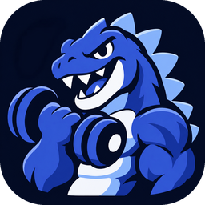
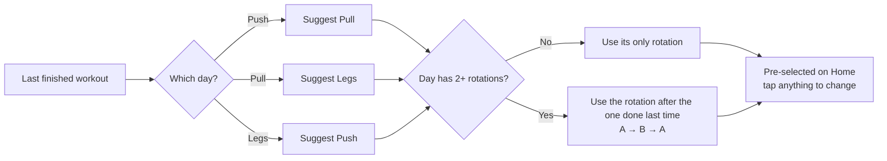
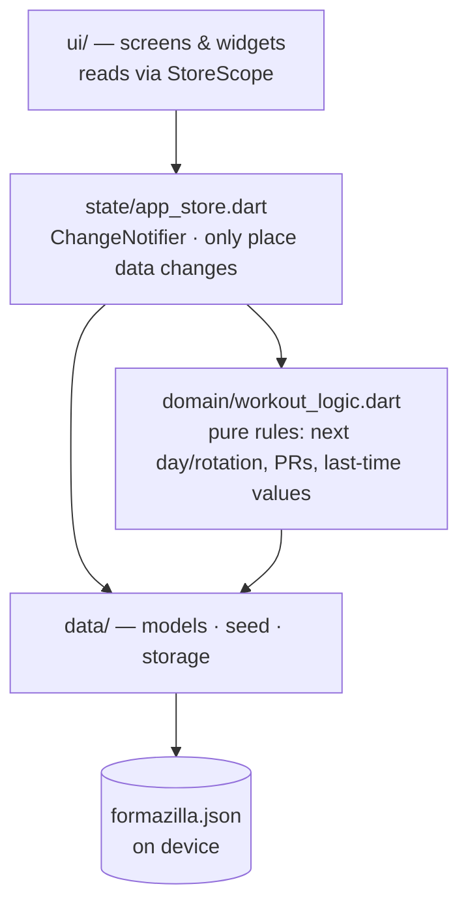

<div align="center">



# Formazilla

**Log a gym set in one tap. See every PR the moment it happens.**

A fast, offline workout logger for Push / Pull / Legs — built in Flutter to replace a messy spreadsheet.

[](https://github.com/osamaayman1005/formazilla/actions/workflows/build.yml)


[**⬇️ Download the APK**](https://github.com/osamaayman1005/formazilla/releases/latest) · [🎨 Design (Figma)](https://www.figma.com/design/bZqhPpEgsoWZtslDjVC8wS) · [🧭 Architecture](#-architecture)

</div>

---

## Why

Tracking weights in a spreadsheet works, until it doesn't: tiny cells, typing `40--55--65--75` with one thumb between sets, and no idea when you actually beat a record.

Formazilla keeps the spreadsheet's speed and drops the friction.

| In a spreadsheet | In Formazilla |
| --- | --- |
| Type every number, every set | Tap last time's weight — **1 tap per set** |
| Scroll back to find what you lifted | "Last: 40 · 55 · 65 · 75" shown on every exercise |
| A separate PRs tab you update by hand | **PRs detected automatically**, highlighted live |
| Remember whether today is Push A or B | **Next day and rotation suggested** — switch with one tap |
| One device, one sheet | Fully offline on your phone, JSON backup anytime |

## ✨ Features

- **⚡ One-tap logging** — last session's weights appear as dashed "ghost" chips. Tap one to log it. `+` opens the keypad for a new weight. Hold a card to drag it up or down.
- **🏆 Automatic PRs** — a set that beats your all-time best turns navy and the exercise shows **New PR**. Home lists your recent PRs with the gain.
- **🔀 Any split** — Push Pull Legs, Upper / Lower, Full body, Bro split, Arnold, or your own. Switch splits in one tap from Home; history and PRs carry over.
- **🔁 PPL with rotations** — Push A / Push B, Pull A / Pull B, a single Legs day… any mix. Days cycle in order, rotations alternate.
- **🧭 Suggest, never enforce** — yesterday was Push, so Pull is pre-selected. Want Legs instead? One tap.
- **❤️ Cardio** — treadmill, bike, or anything you name: one time button, logged in minutes. Hold and drag it anywhere in the workout or template.
- **⚡ One-time workouts** — hotel gym or an evening extra, started from Home. It's kept in History and can set PRs, but never changes your plan or suggestions.
- **🔗 Supersets** — link two exercises; they sit in one card as A and B, and "Next up" alternates for you. Save the pair to the template so it's linked every time.
- **📸 PR share card** — hit a PR, tap Share: a story-size navy card with your number, gain and progress bars, ready for WhatsApp or Instagram.
- **📤 Share a plan** — send one rotation (Push A) or your whole split as a QR code your gym buddy scans, an image card, plain text, or a Formazilla plan they import with one tap. No account or server: the plan rides inside the QR or chat message.
- **✨ Feels alive** — ghosts fill in when logged, new sets pop, PRs glow with a haptic thump, the day picker slides and charts grow in. All under ~0.4s, never blocking a tap, and off when the phone's "Remove animations" is on.
- **🔢 Gym-friendly keypad** — big keys, `±2.5` / `±5` quick buttons, drop-set toggle. No system keyboard popping up.
- **🔎 Autocomplete** — ~60 standard exercise names built in; anything new you type is remembered.
- **📈 Progress** — top weight per session as a chart, full history, and gain since you started.
- **🧱 Your numbers, as typed** — no kg/lb, no per-side math. Machines label things differently; the app just tracks what you enter.
- **📴 100% offline** — no account, no server. Data lives on the device; export/import a backup from History.

## 📱 Screens

Designed in Figma first — [open the design file](https://www.figma.com/design/bZqhPpEgsoWZtslDjVC8wS).

| Screen | What it does |
| --- | --- |
| **Home** | Day switcher (Push · Pull · Legs), A/B rotation toggle, start or resume a workout, recent PRs |
| **Session** | One card per exercise with set chips, ghost values, live PR badge, autocomplete to add exercises |
| **Progress** | Every exercise with its PR → chart of top sets and full history |
| **Templates** | Your rotations per day; add, rename, duplicate, reorder by drag |
| **History** | Past workouts, details, delete, backup |

## 🧠 How the next workout is picked



## 🧭 Architecture

Small, layered, and easy to change. Business rules are plain Dart with unit tests; the UI never computes them.



```
lib/
├── main.dart                  # open storage, start app
├── app.dart                   # theme + bottom-nav shell
├── core/                      # design tokens, formatting
├── data/                      # models, starter templates, JSON storage
├── domain/workout_logic.dart  # all workout rules (pure Dart, tested)
├── state/app_store.dart       # app state + mutations + autosave
└── ui/
    ├── navigation.dart        # all routes in one place
    ├── widgets/               # SetChip, keypad, autocomplete, cards
    └── screens/               # home, session, progress, templates, history
```

**Design choices**

- **Zero code generation, few dependencies** (`path_provider`, `share_plus`, `qr_flutter`, `mobile_scanner`). Builds are fast and reliable.
- **Storage behind an interface** — swapping the JSON file for SQLite/Drift touches one file.
- **Atomic saves** — writes go to a temp file then rename, so a crash never corrupts data.
- **Design tokens in one file** — every colour, radius and text style comes from `core/theme.dart`.

## 🚀 Getting started

**Just want the app?** Grab `formazilla.apk` from [Releases](https://github.com/osamaayman1005/formazilla/releases/latest), open it on your Android phone, and allow "Install unknown apps" if asked. New versions install over the old one and keep your data.

**Developing:**

```bash
git clone https://github.com/osamaayman1005/formazilla.git
cd formazilla
flutter create . --project-name formazilla --org app.formazilla --platforms android   # once: generates android/
flutter pub get
flutter test
flutter run
```

## 🤖 CI/CD

Every push to `main` runs [GitHub Actions](.github/workflows/build.yml):

1. Generate the Android project
2. `flutter analyze` and `flutter test`
3. Build a signed release APK
4. Publish it as a GitHub Release

If a build fails, the workflow opens an issue with the error log. Doc-only changes skip the build.

## 🗺️ Roadmap

- [x] Supersets
- [x] PR share card
- [x] Custom splits: Upper/Lower, Bro split, Full body or your own ([plan](docs/plans/custom-splits.md))
- [ ] First-launch split picker
- [ ] Import history from the old Google Sheet (`40--55--65--75`, `30x3`, `80ds`)
- [ ] Optional reps per set
- [ ] Rest timer between sets
- [ ] Light theme
- [ ] Move storage to Drift (SQLite) once history grows

---

<div align="center">
Built with Flutter · Designed in Figma · Made for lifting, not typing
</div>
